<h1 align="center">Tin Collar</h1>

<p align="center">
  A pixel-art office for <a href="https://claude.com/claude-code">Claude Code</a>, staffed by robots.<br>
  Every agent in your session is a robot at a desk, doing its real work.
</p>

<p align="center">
  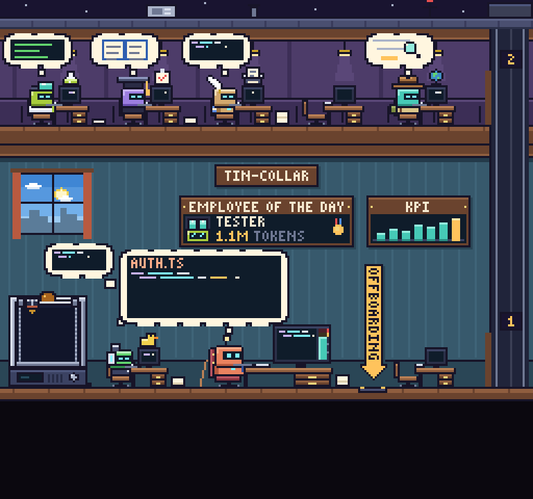
</p>

<p align="center"><sub>
  A designer is printed and briefed. The tester's context is compacted: it hops, shedding bolts into a small pile.<br>
  The writer hands in its report and takes the hatch; the metal comes back out of the printer as an architect.
</sub></p>

## What it does

Tin Collar is a mod for Claude Code. It opens an **Office** pane beside the conversation and draws the session as a small building:

- **The main agent** runs the office from a leather chair at the ground-floor desk. The bubble over its head shows what it is doing right now: the file it reads, the command it runs, the helper it is sending for. With nothing to type, it taps its stick on the desk.
- **Subagents are 3D-printed.** When Claude starts a subagent, the printer in the corner builds a robot, the main agent hands it a blueprint, and the robot walks to a free desk or takes the lift to an upper floor. Robots ordered together are printed one after another, and the printer shows how many are waiting.
- **Finished robots are recycled.** A robot that is done carries its report to the main desk, then jumps through the hatch in the floor, under an amber arrow lettered OFFBOARDING. Under the floor it is dark, and nothing down there can be seen until the hatch swings open: then a shaft of light drops in and shows a ladle of molten metal, the stone wall behind it and the first of a pipe. The splash lights the cellar wide for an instant and shakes a drop or two out of the pipe's joint; when the last drop has fallen the hatch shuts, and the glow of the metal is the last thing to go.
- **The metal comes back.** When the next robot is ordered, a slug of metal leaves the ladle and travels the pipe in the dark, lighting it as it goes, up into the printer, whose vents glow while the robot is built.

<p align="center">
  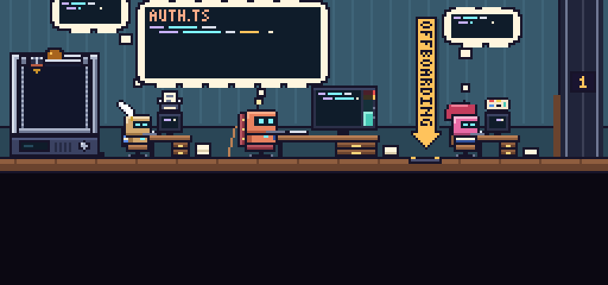
</p>

<p align="center"><sub>
  The writer hands in its report and takes the hatch. Light drops into the cellar, the splash shakes a drop out of the pipe's joint, the hatch shuts.<br>
  Then the metal travels the pipe in the dark and comes out of the printer as an architect.
</sub></p>

- **A stuck robot overheats.** When three of an agent's tool calls fail in a row, its robot turns red, lets off steam at the ears and its screen fills with red; its card says how many have failed. The first call that works cools it down.
- **Robots carry their context.** A robot gets visibly rounder as its context window fills up, at 40k, 80k and 150k tokens. While Claude compacts it, the robot is up from its seat and hops, and with every hop bolts fly out of it into a small pile at its feet. When the compaction is over it sits down slimmer, and the pile is cleared away. The main agent does the same, and its monitor has a gauge built into the case beside the screen: a column that rises as its context nears the point where Claude compacts it, tipped with amber and then with red, and blinking once it stands in the red.
- **Work piles up.** For every file an agent changes, a sheet lands on the stack of papers beside its desk.
- **The room reacts.** A `NEEDS YOU` sign flashes when an agent is waiting for your answer. While its helpers work, an idle main agent takes a coffee break; in an empty office it dozes off and the lights go down. The window shows the sky for the hour on your computer's clock.

<p align="center">
  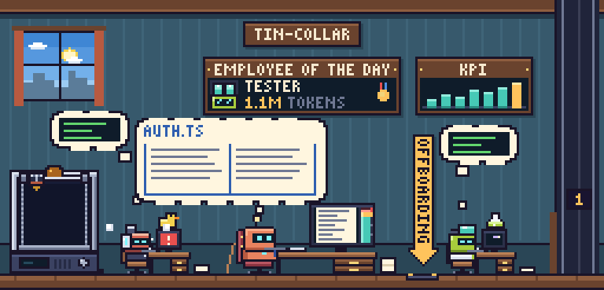
</p>

<p align="center"><sub>
  The coder's tests keep failing: it runs red and lets off steam until one passes. The main agent's gauge stands in the red;<br>
  then its context is compacted: it hops, sheds bolts, sits down slimmer, and the gauge drops.
</sub></p>

- **More robots, more floors.** Two desks on the ground floor, five on each floor above it, up to four upper floors: 22 robots at once.

<p align="center">
  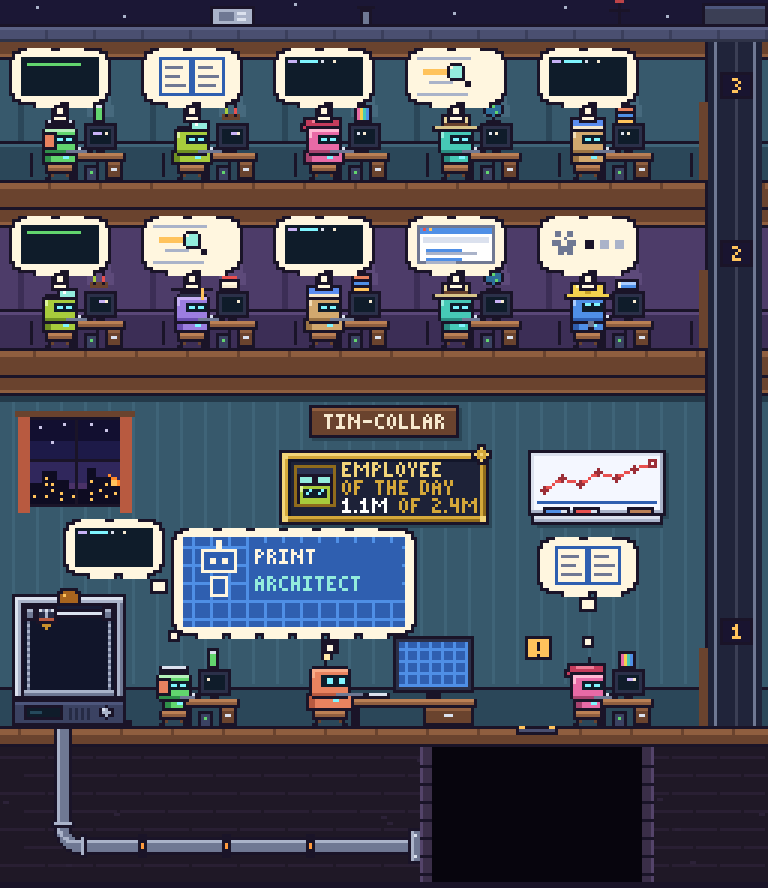
</p>

## Dressed for the job

Each robot is painted and dressed for its role, keeps a thing of its own on its monitor, and carries another whenever it has a hand free. The role comes from the task the subagent was given ("review the auth module", "design the icons"), and from its agent type when the task does not say.

<table>
  <tr>
    <td align="center">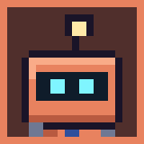<br><b>Main agent</b><br><sub>antenna, tie<br>a stick and a boss's chair</sub></td>
    <td align="center">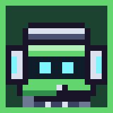<br><b>Coder</b><br><sub>headset, hoodie<br>a smoothie, on a monowheel</sub></td>
    <td align="center">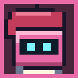<br><b>Designer</b><br><sub>beret, striped shirt<br>palette and brush</sub></td>
    <td align="center">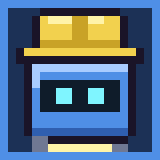<br><b>Architect</b><br><sub>hard hat, hi-vis vest<br>a folding rule, on tracks</sub></td>
    <td align="center">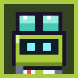<br><b>Tester</b><br><sub>goggles, lab coat<br>a fly swatter for the bugs</sub></td>
  </tr>
  <tr>
    <td align="center">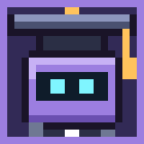<br><b>Reviewer</b><br><sub>mortarboard, gown<br>a magnifying glass</sub></td>
    <td align="center">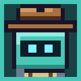<br><b>Explorer</b><br><sub>fedora, backpack<br>a burning torch</sub></td>
    <td align="center">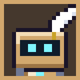<br><b>Writer</b><br><sub>quill, scarf<br>its nose in a book</sub></td>
    <td align="center">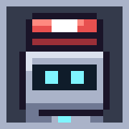<br><b>Helper</b><br><sub>cap, tool belt<br>a wrench</sub></td>
  </tr>
</table>

## On the wall

- **The sign** carries the name of the folder the session works in.
- **Employee of the Day** is a plate with the portrait of the robot that has used the most tokens today, what it is, and how many it has used.
- **KPI** is the plate beside it. The office has one key performance indicator, tokens got through: a bar for each of the last seven days, across all your chats, with today's in amber.

Both plates are made the way the sign is: the same wood and lettering across the head, over a dark face. Everything in the office that shows a number follows one code: cream is what you read first, teal is a quantity, amber is today's or a warning, red is what needs minding.

## Under the picture

Below the office is a task list with one card per agent: its portrait, what it is doing, a progress bar and how much context it carries. The bar has a cell for each step of the agent's own plan when it keeps one, and otherwise a cell for each thing it has done, in the colour of what that was. Each card has a square frame a pixel thick with its robot's colour down the near edge, a chip that says how the task stands, and a mark that shows whether it is open.

The lamp in the corner of the portrait says the same as the chip:

<table>
  <tr>
    <td align="center">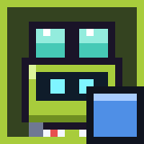<br><b>Working</b><br><sub>the lamp blinks</sub></td>
    <td align="center">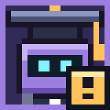<br><b>Needs you</b><br><sub>waiting for your answer</sub></td>
    <td align="center">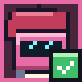<br><b>Done</b><br><sub>report handed in</sub></td>
    <td align="center">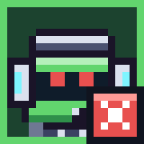<br><b>Stopped or stuck</b><br><sub>failed, or three failures in a row</sub></td>
  </tr>
</table>

Click a card to open the agent's trace: its plan, its recent steps, its latest change and its last message. Click it again to close it. In the desktop app you can also click the robot itself. Agent rows in the chat get the robot's portrait too, and opening an agent from Claude Code's own task list opens its card here.

Under the tasks is a **Changes** card: the files changed in this chat, the latest first, each with who changed it. Click a file to see its latest change.

In a terminal there are no pictures; you get the task list, the traces and the changes.

## Install

At the prompt of a Claude Code terminal session:

```
/plugin install tin-collar --marketplace dzmitrybykau/tin-collar
```

Answer `y` to add the marketplace, then choose a scope. The user scope turns the office on for every session.

From a shell:

```bash
claude plugin install tin-collar --marketplace dzmitrybykau/tin-collar
```

In the desktop app, where `/plugin` does not run: click **+** next to the prompt box, then **Plugins**, **Add marketplace** with `dzmitrybykau/tin-collar`, then **Add plugin**. A mod installed from a terminal at the user scope also loads in the desktop app's local sessions.

Built and tested on Claude Code 2.1.325.

## Use

The Office pane opens beside the chat by itself. If you close it, `/office` brings it back.

There is nothing to configure. Start a few subagents and watch the printer.

## Update or remove

```bash
claude plugin marketplace update tin-collar
```

```bash
claude plugin update tin-collar@tin-collar
```

```bash
claude plugin uninstall tin-collar@tin-collar
```

## Privacy

Tin Collar makes no network requests, reads no files and starts no processes. It draws from what Claude Code already gives a mod about the session: tool calls, subagents starting and stopping, token usage, and an agent's latest message for its trace. It keeps one thing between sessions: the number of tokens used per day, in Claude Code's own plugin store on your computer.

## Development

```bash
git clone https://github.com/dzmitrybykau/tin-collar
```

```bash
claude --plugin-dir tin-collar
```

```bash
claude plugin validate tin-collar
```

```bash
claude plugin test tin-collar
```

| File | What it holds |
| --- | --- |
| `hooks/register.tsx` | The hooks: turns session events into the state of the office, draws the pane and the task cards |
| `hooks/scene.ts` | The pixel renderer: the robots and what they wear, the building, and every robot's timeline |
| `hooks/tally.ts` | Token counts per robot and per day |
| `hooks/hit.tsx` | The click layer over the picture and over each card |
| `types/index.d.ts` | The type contract for the mod's state |
| `tests/office.test.tsx` | Tests for the behaviour described above |

The picture is drawn into a small pixel framebuffer, converted to SVG paths and animated with SMIL. It is laid in layers. The room is one layer: everything that stays in its place. The light that falls into the cellar is another. Each journey a robot makes (being printed and walking to its desk, or carrying its report and dropping into the vat) is a layer of its own, laid once and left alone until the journey is over. So whatever the agents do meanwhile, a robot on its way is never moved, and however many helpers are ordered at once, each one's journey plays from start to end. That is why nothing jumps and nothing flickers.

## License

[MIT](LICENSE)
